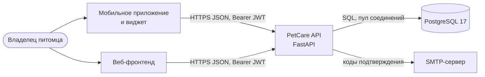
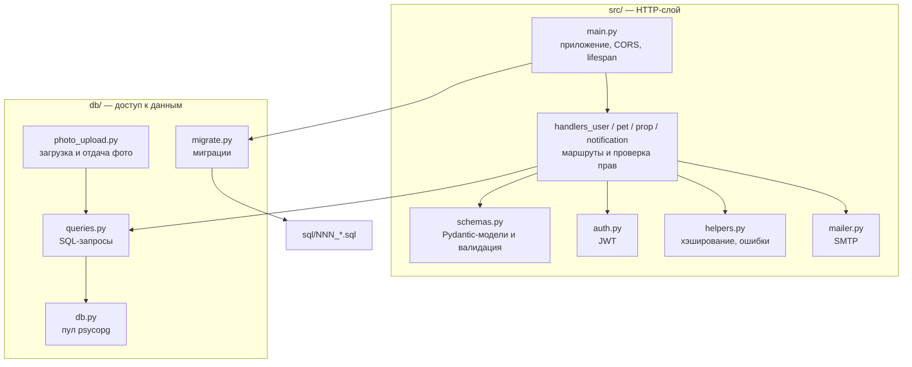
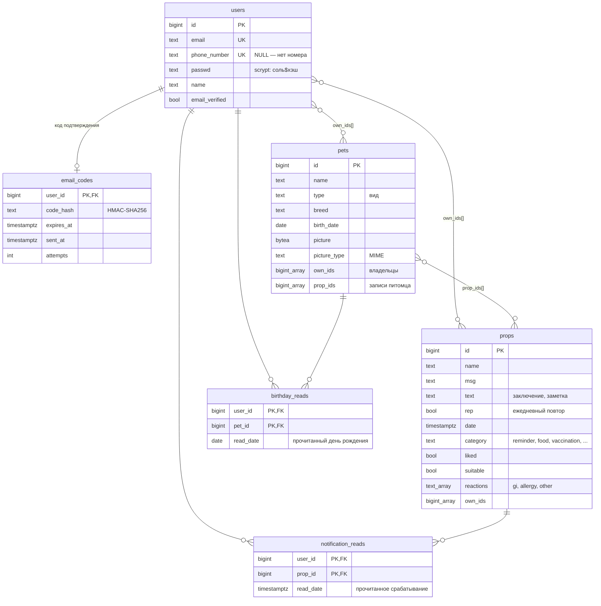
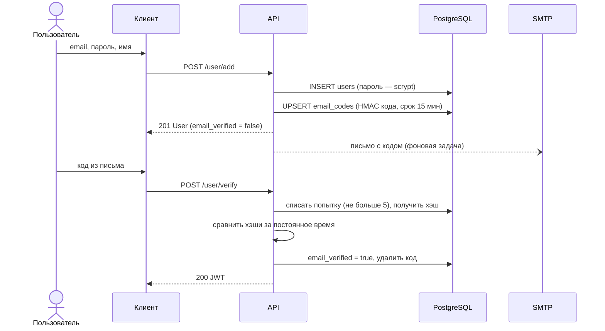
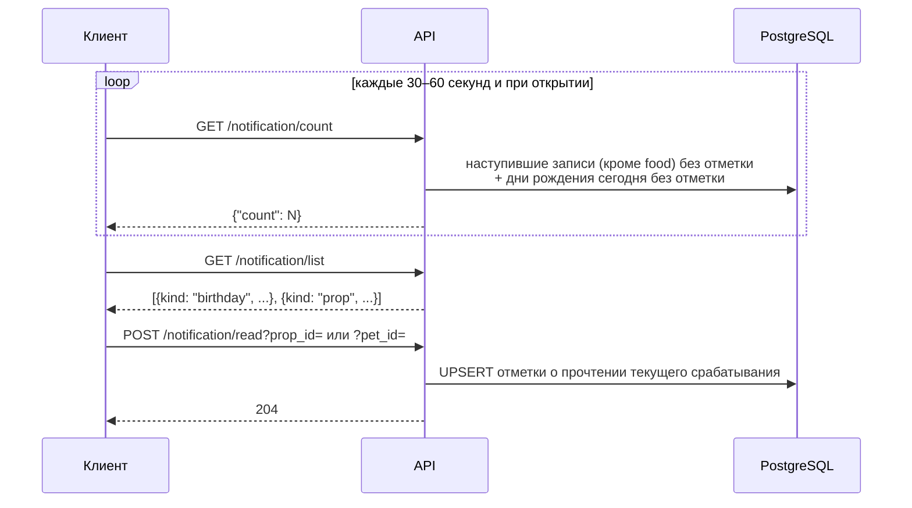
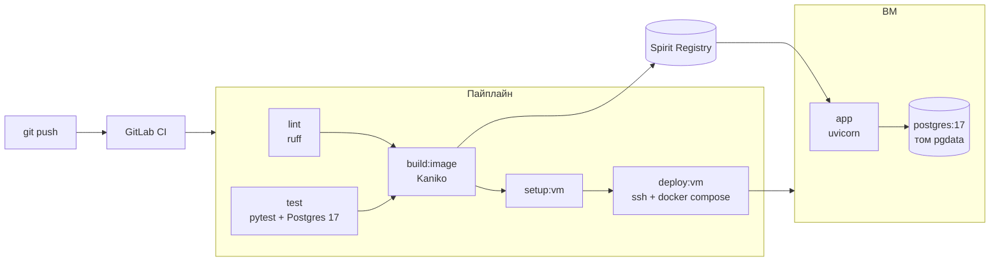

# PetCare backend — архитектура

Документ описывает бэкенд в том виде, в котором он лежит в репозитории: требования, компоненты, модель данных, API и инфраструктуру. Для каждого решения указано, почему выбрано именно оно. Подробный контракт для фронтенда и мобилки — в [API.md](API.md), запуск и деплой — в [README.md](README.md).

Содержание:

1. [Требования](#1-требования)
2. [Архитектура и компоненты](#2-архитектура-и-компоненты)
3. [Модель данных](#3-модель-данных)
4. [API и ключевые сценарии](#4-api-и-ключевые-сценарии)
5. [Инфраструктура, развёртывание и качество](#5-инфраструктура-развёртывание-и-качество)
6. [Масштабирование и расширение](#6-масштабирование-и-расширение)

---

## 1. Требования

### 1.1 Контекст

Владельцы домашних животных забывают сроки вакцинаций и обработок, не помнят, какие корма подошли, и хранят историю здоровья в разных местах. PetCare собирает всё это в одном сервисе и напоминает о процедурах. Бэкенд — единый источник данных для мобильного приложения, веб-фронтенда и виджета на рабочем столе.

Основной пользователь — владелец питомца: вносит данные, получает напоминания, ведёт историю. Питомцем часто занимается семья, поэтому у питомца может быть несколько владельцев.

### 1.2 Функциональные требования

| ТЗ | Требование | Как реализовано |
|---|---|---|
| 5.1 | Создание карточки питомца | `POST /pet/add`, обязательно только `name` — карточка создаётся за один шаг |
| 5.1 | Имя, вид, порода, дата рождения | `pets.name`, `type`, `breed`, `birth_date` (дата из будущего — 422) |
| 5.1 | Фотография | `POST/GET/DELETE /pets/{id}/photo`, JPG/PNG/WEBP до 5 МБ |
| 5.1 | Список питомцев пользователя | `GET /pet/list` |
| 5.2 | История вакцинаций | Записи `props` с `category = vaccination`, `GET /prop/list?pet_id=&category=vaccination` |
| 5.2 | История обработок от паразитов | `category = parasites` |
| 5.2 | Посещения ветеринара и заключения | `category = vet_visit`, текст заключения — в `props.text` |
| 5.3 | Записи о кормах | `props` с `category = food` |
| 5.3 | Понравилось / не понравилось | `props.liked` (`null` — не оценено) |
| 5.3 | Подошло / не подошло | `props.suitable` (`null` — не оценено) |
| 5.3 | Нежелательные реакции (ЖКТ, аллергия) | `props.reactions` ⊆ {`gi`, `allergy`, `other`} |
| 5.3 | История питания и личная база предпочтений | `GET /prop/list?pet_id=&category=food`, корма, которые подошли, — `&suitable=true` |
| 5.4 | Назначения препаратов | `category = medication` |
| 5.4 | Регулярность приёма | `props.rep` — ежедневное повторение, срабатывание вычисляется на сервере |
| 5.4 | Напоминания о предстоящих процедурах | Наступившая запись становится уведомлением: `GET /notification/list`, счётчик `GET /notification/count` |
| 5.4 | Список событий | `GET /prop/list` — события питомца по дате, с фильтром по типу |
| 5.4 | Уведомления для приложения и виджета | Единый API уведомлений, который одинаково читают приложение и виджет на рабочем столе |
| 6 | «Сегодня день рождения Барсика» | Уведомление `kind = birthday` в день рождения питомца |

Сверх ТЗ: подтверждение почты кодом, несколько владельцев у питомца и записи, отметка «прочитано» у каждого владельца своя.

### 1.3 Нефункциональные требования

| Требование | Откуда | Как обеспечено |
|---|---|---|
| Понятные ошибки форм, подсветка поля | ТЗ 7, 8 | Валидация Pydantic: 422 с `loc` — путём до поля (`["body", "name"]`). Бизнес-ошибки — 400/404/409 с текстом в `detail` |
| Данные видит только владелец | Здоровье питомца — личные данные | Каждый запрос фильтруется по `user_id` из JWT. На чужой объект ответ 404, а не 403, чтобы не раскрывать, что он существует |
| Защита учётных записей | — | Пароли — scrypt с солью; код подтверждения хранится как HMAC-хэш; 5 попыток ввода, срок жизни 15 минут, повторная отправка не чаще раза в минуту |
| Работа на мобильных устройствах | ТЗ 8 | Компактный JSON API без серверного рендеринга; одно приложение обслуживает веб, мобилку и виджет |
| Простота проверки и деплоя | Критерии жюри | Docker-образ, `docker compose`, автоматические миграции, CI/CD в GitLab, Swagger на `/docs` |
| Сопровождаемость | — | 102 теста, покрытие 99 %, линтер ruff в CI; деплой блокируется, если тесты упали |

---

## 2. Архитектура и компоненты

### 2.1 Контекст

### 2.2 Слои внутри приложения

| Компонент | Ответственность |
|---|---|
| `src/main.py` | Создаёт приложение; при старте применяет миграции и открывает пул соединений; подключает CORS и роутеры |
| `src/handlers_*.py` | HTTP-маршруты: разбирают запрос, вызывают запрос к БД, переводят результат в коды ответа (404, 409 …) |
| `src/schemas.py` | Контракт API: входные и выходные модели, правила валидации (дата рождения не в будущем, поля оценки корма только для `food`) |
| `src/auth.py` | Выпуск и проверка JWT (HS256, 24 часа); зависимость `current_user_id` для защищённых ручек |
| `src/mailer.py` | Отправка писем; без `SMTP_HOST` письмо пишется в лог — для локальной разработки |
| `db/queries.py` | Весь SQL приложения: явные запросы с параметрами, проверка ссылок (`own_ids`, `prop_ids`) |
| `db/photo_upload.py` | Ручки фото: проверка типа, размера и сигнатуры файла |
| `db/migrate.py` | Применяет `sql/*.sql` по порядку, ведёт `schema_migrations` |

### 2.3 Решения и обоснования

**Монолит на FastAPI, а не микросервисы.** Предметная область маленькая (пользователи, питомцы, записи), команда — несколько человек, срок — хакатон. Один процесс проще деплоить, тестировать и отлаживать. FastAPI выбран за автоматический Swagger (сразу закрывает документацию API), валидацию через Pydantic и понятные 422-ошибки по полям, которые нужны фронтенду для подсветки.

**SQL-запросы вручную через psycopg 3, без ORM.** Запросы с массивами, `LATERAL`, `ON CONFLICT` и вычислением срабатываний повторов выражаются в SQL короче и прозрачнее, чем через ORM. Все запросы параметризованы — SQL-инъекции исключены. Согласованность схемы и запросов проверяется интеграционными тестами на настоящем Postgres.

**PostgreSQL.** Нужны транзакции, внешние ключи, массивы с GIN-индексами, `TIMESTAMPTZ` и работа с часовыми поясами для дней рождения. Всё это есть в Postgres из коробки.

**Синхронные обработчики и пул соединений.** FastAPI выполняет синхронные обработчики в пуле потоков, поэтому блокирующий драйвер не останавливает приложение. Нагрузка сервиса — единицы запросов в секунду на пользователя, асинхронный стек усложнил бы код без выигрыша.

**Stateless-аутентификация по JWT.** Сервер не хранит сессии, токен одинаково работает для веба, мобилки и виджета, а проверка токена не требует обращения к БД. Токен живёт 24 часа; при 401 клиент отправляет пользователя на вход.

---

## 3. Модель данных

### 3.1 Схема

### 3.2 Решения и обоснования

**Одна таблица `props` для напоминаний, истории здоровья и питания.** Вакцинация, обработка, визит, корм и приём препарата устроены одинаково: название, дата, заметка, привязка к питомцу. Поле `category` отличает их друг от друга, поэтому одна ручка списка с фильтром закрывает экраны «Карта здоровья», «Питание» и «Напоминания». Поля оценки корма (`liked`, `suitable`, `reactions`) принимаются только для `category = food` — иначе API отвечает 422. Допустимые значения `category` и `reactions` дополнительно закреплены ограничениями `CHECK` в БД. Новый тип записи добавляется одним значением `category` без новых таблиц и ручек.

**Владельцы и связи хранятся массивами (`own_ids`, `prop_ids`).** Запись может принадлежать нескольким владельцам и быть привязана к питомцу. Массивы с GIN-индексами (`002_owner_indexes.sql`) дают быстрый запрос «все мои объекты» (`%s = ANY(own_ids)`) без таблиц-связок и `JOIN`. Целостность ссылок обеспечивает приложение: при записи проверяется, что пользователи существуют, а привязываемые записи принадлежат текущему пользователю (`_check_refs`, иначе 400). При удалении пользователя он убирается из всех массивов в одной транзакции, а объекты, у которых не осталось владельцев, удаляются.

**Фото хранится в БД (`BYTEA`), а не в объектном хранилище.** Одно фото на питомца, до 5 МБ. Хранение в строке убирает отдельный сервис, синхронизацию файлов с БД и проблемы с правами: фото удаляется вместе с питомцем, а доступ проверяется тем же условием `own_ids`. Список питомцев отдаёт только флаг `has_picture`, само изображение отдаётся отдельной ручкой, поэтому списки остаются лёгкими. Тип файла проверяется по сигнатуре содержимого, а не по расширению.

**Отметки «прочитано» — отдельные таблицы на пару (пользователь, объект).** У записи несколько владельцев, и прочитать уведомление должен каждый сам, поэтому состояние нельзя хранить в `props`. В `read_date` хранится, *какое* срабатывание прочитано. Повторяющаяся запись срабатывает каждый день, и новое срабатывание позже прочитанного снова становится уведомлением. Так повторы работают без фоновых задач и без изменения исходной `date`.

**Секреты не хранятся в открытом виде.** Пароль — scrypt (n = 2¹⁴) с уникальной солью. Код подтверждения короткий, поэтому хранится HMAC-SHA256 с серверным секретом: по утёкшей базе код не подобрать перебором.

**Миграции — пронумерованные SQL-файлы, применяются при старте приложения.** `db/migrate.py` применяет новые файлы из `sql/` по порядку, каждый в своей транзакции, и записывает их в `schema_migrations`. Advisory-блокировка не даёт двум экземплярам применять миграции одновременно. Если миграция упала, она откатывается, и приложение не стартует — сломанная схема не попадает в работу. Отдельный инструмент (Alembic) не нужен: запросы и так написаны на SQL.

---

## 4. API и ключевые сценарии

### 4.1 Ресурсы

| Ресурс | Ручки | Назначение |
|---|---|---|
| `/user` | `add`, `verify`, `verify/resend`, `login`, `me`, `edit`, `del` | Регистрация, подтверждение почты, вход, профиль |
| `/pet` | `add`, `get`, `list`, `edit`, `del` | Карточки питомцев |
| `/pets/{id}/photo` | `POST`, `GET`, `DELETE` | Фото питомца |
| `/prop` | `add`, `get`, `list` (фильтры `pet_id`, `category`, `liked`, `suitable`), `edit`, `del` | Напоминания, история здоровья, журнал питания |
| `/notification` | `list`, `count`, `read`, `read_all` | Уведомления: наступившие записи и дни рождения |

Все ручки, кроме регистрации, подтверждения и входа, требуют `Authorization: Bearer <JWT>`. Формат ошибок единый: `{"detail": ...}`. Полный контракт — в [API.md](API.md) и в Swagger на `/docs`.

### 4.2 Регистрация и подтверждение почты

Почту подтверждаем, чтобы аккаунт был привязан к реальному адресу, которым владеет пользователь, и чтобы нельзя было занять чужую почту. Код отправляется фоновой задачей после ответа, поэтому медленный SMTP не задерживает регистрацию. `verify/resend` всегда отвечает 204, чтобы по ответу нельзя было узнать, зарегистрирована ли почта.

### 4.3 Уведомления

Уведомление ничего не хранит: оно вычисляется запросом в момент обращения.

- **Запись** — уведомление, если её `date` наступила, `category ≠ food` и текущий пользователь ещё не прочитал её последнее срабатывание. Записи о кормах — история питания, а не напоминания.
- **Повтор** (`rep = true`) срабатывает каждый день начиная с `date`; последнее срабатывание вычисляется в SQL.
- **День рождения** — уведомление весь день рождения питомца (часовой пояс задаётся `TIMEZONE`, по умолчанию `Europe/Moscow`), начиная с первой годовщины. Родившиеся 29 февраля в невисокосный год получают уведомление 28-го.

**Почему опрос, а не push или фоновый планировщик.** Вычисление по запросу не требует воркера, очереди и хранения «отправленных» уведомлений, и всегда согласовано с данными: перенесли дату — уведомление пересчиталось. Счётчик — один индексируемый запрос, опрос раз в 30–60 секунд даёт ничтожную нагрузку. Тот же API читает виджет на рабочем столе — ТЗ предусматривает уведомления «через push или виджет».

### 4.4 Права доступа

Каждый запрос к объекту содержит условие `текущий пользователь ∈ own_ids`. Для чужого или несуществующего объекта ответ одинаковый — 404, поэтому по ответам нельзя перебрать чужие id. Создатель всегда остаётся среди владельцев: даже если клиент передал список владельцев без себя, сервер добавит его обратно и пользователь не потеряет доступ к своему объекту.

---

## 5. Инфраструктура, развёртывание и качество

### 5.1 Развёртывание

- **Образ.** Многостадийный `Dockerfile`: `dev` — с зависимостями разработки и автоперезагрузкой, `prod` — только рабочие зависимости, процесс от непривилегированного пользователя `app`.
- **ВМ.** `deploy/docker-compose.yml`: приложение и Postgres в одной сети; приложение стартует только после healthcheck БД; оба сервиса с `restart: unless-stopped`; данные БД — в томе `pgdata`.
- **Конфигурация.** Только через переменные окружения. Секреты (`POSTGRES_PASSWORD`, `JWT_SECRET`, `SMTP_PASSWORD`, SSH-ключ) хранятся в защищённых CI-переменных Spirit и передаются на ВМ в `.env` с правами 600, в репозиторий не попадают.
- **Миграции** применяются самим приложением при старте, ручных шагов при деплое нет.
- **Локально:** `make run-dev` поднимает тот же стек с монтированием исходников.

**Почему одна ВМ и docker compose, а не Kubernetes.** Для одного сервиса и одной базы compose даёт воспроизводимый запуск одной командой и не требует обслуживать кластер. Приложение не хранит состояние, поэтому при росте его можно запустить в нескольких экземплярах за балансировщиком: миграции защищены блокировкой от параллельного запуска.

### 5.2 Пайплайн

| Стадия | Джоба | Когда | Что делает |
|---|---|---|---|
| test | `lint` | MR и `master` | `ruff check .` |
| test | `test` | MR и `master` | Интеграционные тесты с сервисом `postgres:17`, отчёты JUnit и покрытия (Cobertura, HTML) |
| build | `build:image` | MR и `master` | Сборка prod-образа Kaniko и публикация в Spirit Registry |
| deploy | `setup:vm`, `deploy:vm` | только `master` | Установка CLI, выкладка compose-файла и `.env`, `docker compose pull && up -d` |

Если `lint` или `test` упали, стадия `build` не запускается, и непроверенный код не попадает на сервер.

### 5.3 Тестирование

- **Интеграционные тесты** (`tests/test_user.py`, `test_pet.py`, `test_prop.py`, `test_food.py`, `test_photo.py`, `test_notification.py`) отправляют HTTP-запросы в приложение через `TestClient` и работают с настоящим PostgreSQL: схема создаётся тем же `migrate()`, что и в проде, таблицы очищаются перед каждым тестом. Проверяются сценарии ТЗ (карточка питомца, история здоровья, питание и фильтр подходящих кормов, напоминания и дни рождения), права доступа к чужим объектам и ошибки валидации.
- **Юнит-тесты** (`test_helpers.py`, `test_mailer.py`): хэширование паролей и кодов, JWT, склонение «год / года / лет», отправка почты с подменённым SMTP.
- **Время в тестах** не мокается: нужное состояние («прошли сутки», «прошёл год») создаётся сдвигом дат в БД, поэтому проверяется настоящий SQL.
- **Итог:** 102 теста, покрытие строк 99 %. В пайплайне список сценариев виден во вкладке Tests, покрытие — в артефакте `htmlcov/`.

---

## 6. Масштабирование и расширение

- **Горизонтальное масштабирование.** Приложение не хранит состояние, поэтому его можно запустить в нескольких экземплярах за балансировщиком: аутентификация stateless, а миграции защищены advisory-блокировкой от параллельного запуска.
- **Новые типы записей** добавляются значением `category` — модель данных, ручки и уведомления уже работают с ними единообразно.
- **Новые каналы уведомлений** (push FCM / RuStore, email-дайджест) подключаются поверх существующего запроса наступивших уведомлений: он уже учитывает повторы, дни рождения и отметки о прочтении, поэтому канал только доставляет результат, а API не меняется.
- **Хранилище фото** вынесено в два запроса (`set_pet_picture`, `get_pet_picture`), поэтому при росте объёма его можно заменить на S3-совместимое без изменения API.
